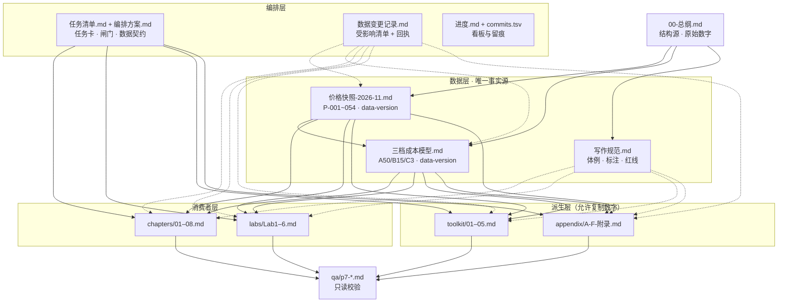

# 文档依赖与数据血缘图

> 本图描述仓库内各文档之间的**生产/引用关系**，不是阅读顺序（阅读路径见 [README.md](../README.md)）。
> 类型：**文档依赖图**（Document Dependency Graph，结构为 DAG）；因为核心是「数据从哪来、改一处影响谁」，也可称**数据血缘图**（Data Lineage）与**影响分析图**（Impact Analysis）。表格形态的对应物是**追溯矩阵**（Traceability Matrix），本仓库的 `ops/数据变更记录.md` 已是雏形。

## 一、主图

### 线型图例

| 线型 | 含义 | 涉及边 |
|---|---|---|
| 实线 `-->` | **内容/数据依赖**：下游引用上游的编号、数字或结构 | 总纲→数据层；数据层→消费者/派生层；编排方案→产物；产物→QA |
| 虚线 `-.->` | **规范约束或变更传导**：不改变内容，但决定怎么写、改了要同步谁 | 写作规范→全部产物；数据变更记录→数据层与全部下游 |
| 单独节点 | **只读校验**：QA 只读正文，不回写 | `qa/p7-*.md` |

`B --> C` 特指三档成本模型依赖价格快照（`data-version` 对齐）；`A --> B/C/D` 指三份底座都以总纲为上游，其中总纲 10.3 的示意饼图与模型第五节是**主动不同步的并存口径**（登记为 D-006）。

## 二、变更传导链（数据血缘视角）

这条链是补上「更新契约」后的核心：历史上 `a1ded7b`（点名边界）和 `69922a2`（月流量换算）只改了数据层、下游没跟，才造成 Q1 的红灯；现在任何数据变更都必须走完这条链才能收尾。

## 三、分层职责

| 层 | 文件 | 职责 | 能否自行引入数字 |
|---|---|---|---|
| 结构层 | `00-总纲.md` | 8 篇大纲、原始数字、学习路径 | 原始来源，示意口径需标注 |
| 数据层 | `_shared/*.md` | 唯一事实源，带 `data-version` | ✅ 唯一有权定义数字 |
| 编排层 | `ops/*.md` | 任务卡、闸门、看板、变更台账 | ❌ 只登记，不定义 |
| 消费者层 | `chapters/`、`labs/` | 引用编号与基准值写正文 | ❌ 只引 `P-xxx`，不抄价格表 |
| 派生层 | `toolkit/`、`appendix/` | 可填模板、索引、推导过程 | ⚠️ 允许复制模型参数成派生表，本次 P7 暂不加来源戳（Q2-08 / Q3-06 登记） |
| 校验层 | `qa/` | 8 项只读质检 | ❌ 只读，问题写进报告 |

## 四、旁支资产（不参与内容依赖）

| 路径 | 性质 |
|---|---|
| `.workbuddy/agents/vps-*.md` | WorkBuddy 子 agent 定义（生产工具，非内容上游） |
| `.opencode/agents/vps-*.md` | opencode 原版契约，正文被上者 100% 复用 |
| `plans/P7-执行计划.md` | 历史执行计划，一次性快照 |
| `ses_*.json` | opencode 会话导出，仅作溯源 |
| `README.md` / 本文件 | 入口与关系说明 |

## 五、维护规则

1. 新增或移动任一产物目录时，同步更新本图、`README.md` 目录表、`ops/编排方案.md` 第 1 节产物表、`ops/commits.tsv`。
2. 任何数据层版本变更，先按第二节的链路走完，再更新图中节点上的 `data-version` 标注。
3. 本图的 Mermaid 源码可直接渲染；若渲染器不支持 subgraph，可退化为纯节点 + 实线箭头，语义不变。
4. 图的变更按 `chore(repo)` 或 `chore(ops)` 前缀提交，遵守 `ops/编排方案.md` 的闸门 ⑥⑦（精确路径、不带 `-A`）。
